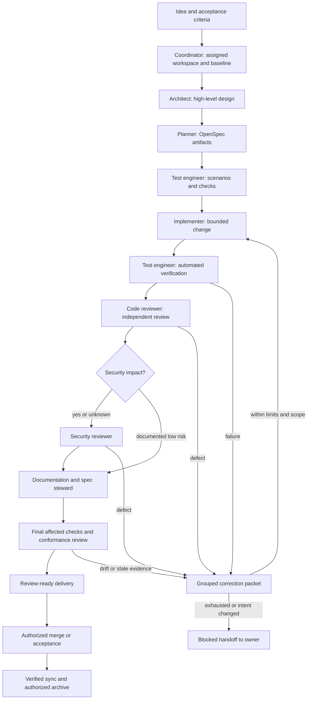

# Lifecycle and handoffs

These are logical phases, not replacement queue states. Map them to the existing
runtime and OpenSpec workflow. Never invent transitions in a deployed scheduler.

Documentation accompanies implementation; the steward's late pass checks the
whole package. It is not permission to postpone essential docs until after merge.
Architecture can include an early security consultation for a high-risk design;
that does not replace review of the implemented candidate.

## Phase contracts

| Phase | Owner | Inputs | Outputs and exit criteria |
| --- | --- | --- | --- |
| Intake | Coordinator + user | Idea, context, authority | Bounded problem, endpoint, acceptance, budget and open questions |
| Workspace | Coordinator | Host binding, Git state, preferences, setup policy | Reused/created workspace, baseline evidence, writer and separate-store ownership |
| Architecture | Architect | Intake, current code/docs | High-level design, decisions, evidence and risk boundaries |
| Plan | Planner | Design, current specs, active schema | Coherent required artifacts; actual strict-validation result |
| Test design | Test engineer | Requirements/scenarios | Traceable checks and fixtures; baseline/edge cases; reviewed policy |
| Implementation | Implementer | Approved tasks, tests, constraints | Small source/test/doc change; actual fast-check evidence |
| Verification | Test engineer | Frozen candidate and environment | Required automated/acceptance results tied to candidate |
| Code review | Code reviewer | Actual diff, intent and evidence | Independent pass or actionable findings; author session excluded |
| Security | Security reviewer when indicated | Triage, diff and reachable paths | Scope-specific verdict or justified low-risk disposition |
| Coherence | Documentation/spec steward | Code, tests, docs, deltas | Updated docs; validated sync; implementation/spec agreement |
| Delivery | Coordinator | Complete evidence packet | Requested branch/PR, actual CI status, unresolved limits |
| Completion | Authorized owner | Accepted delivery | Merge/acceptance and later archive as explicitly authorized |

Eight roles exceed a minimal business-automation team because the user workflow
needs distinct authoring, testing, independent review, security, and documentation
responsibilities. They are eight role definitions, not eight always-running
workers. Invoke only needed roles; keep at most one writer in a worktree. Small
documentation-only changes can use a shorter path with explicit applicability
decisions. Never shorten the path by labeling required evidence “optional.”

Establish [workspace ownership](worktrees.md) before authoring change artifacts,
including architecture and planning. Read-only analysis can precede setup. Share one worktree
across serialized writer phases; additional role sessions do not need additional
worktrees. Keep separate-store ownership explicit and retain work through delivery.

## OpenSpec adapter

This adapter builds on OpenSpec's workflow and skills by Fission AI and the
OpenSpec contributors. See [attribution and upstream sources](../third_party/openspec/README.md)
and the bundled [MIT license](../third_party/openspec/LICENSE). The following
instructions adapt those workflows to this team's roles and evidence gates.

1. Discover the repository's pinned command/wrapper and generated workflows.
   Read local rules first. On supported versions, `context --json` and
   `status --change <id> --json` identify the planning root, selected store,
   active schema, artifact graph, paths, and implementation prerequisites.
2. Preserve an explicitly selected store on every command that supports it.
   A planning store may be separate from the code repository. Do not assume the
   current directory is the planning root, and never silently switch stores.
   Verify the selected store's workspace, branch and writer ownership before any
   artifact write; code-worktree ownership alone does not authorize store edits.
3. Get artifact-specific instructions before creating or substantially rewriting
   artifacts. Follow dependency edges, not a fixed filename order. A tasks file
   existing does not prove its dependencies are complete. Honor real schema-defined
   skips; do not create your own bypass for missing required specs.
4. Use concrete existing output paths for updates/sync. A glob output pattern is
   not a writable filename. Preserve nested capability names and caller-narrowed
   selections. Do not infer specs from an unrelated change directory.
5. Apply the installed propose/apply/update/sync/archive workflows within the
   user's established scope. Generated workflow boilerplate does not erase prior
   authorization; it also cannot grant additional authority. Discover supported
   operations rather than inventing a `sync` CLI command.
6. Run the repository's strict spec-validation command at planning and after
   changes to specs. Record both structural validity and semantic review; they
   answer different questions. Older CLI versions need their documented adapter,
   not guessed flags or fields.

## Canonical spec synchronization

Sync changes on the authorized feature branch before delivery when the planning
root shares that repository. If specs live in another store, use its authorized
branch, review its diff, and link the paired change. Record acceptance/merge order
so the canonical specs never imply unaccepted work is live. Do not mutate another
repository's default branch merely because a local CLI resolves there.

Compare each selected delta with the resulting main spec: additions present,
modifications complete, removals applied, renames reconciled, unrelated scenarios
preserved. Validate and perform a second comparison. No remaining delta is the
idempotence check; a second write should be unnecessary. Archive is a later
operation and waits for sync, actual completion, and its authority.

## Candidate identity and correction handoff

Use the host's content fingerprint or a trusted snapshot digest covering source,
tests, configuration, relevant specs/docs, and substantive delivery claims. Record
head plus dirty-diff identity when not committed; include separate-store revisions.
Do not use the commit SHA alone as proof of an uncommitted candidate.

Mechanical logs/receipts may be stored outside the candidate or excluded by a
reviewed policy, but application files and substantive claims cannot be excluded
to keep old checks green. New semantic content creates a new candidate. Reuse
unaffected evidence only through an explicit host-supported equivalence check;
otherwise rerun required checks on the final candidate. The bundled checker takes
a conservative approach and requires the exact expected identity for every receipt.

Corrections include finding IDs, affected requirements, reproduction, intended
fix scope, required regression checks, prior attempts, and exit criteria. Resume
the relevant reviewer with the previous findings and the changed diff. Keep
material source changes serialized and reviewer contexts independent of authors.
